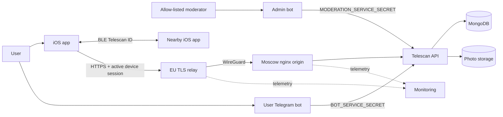

# Architecture and Trust Boundaries

## Product boundary

Telescan is an iOS application that discovers other Telescan installations over
Bluetooth Low Energy and lets authenticated users open the public Telegram
profile each person chose to share. BLE is a local discovery transport; the API
owns account identity, sessions, public profiles, photos, reports, and blocks.

Telescan does not read Telegram messages or contacts. GPS, RSSI, approximate
distance, the live nearby list, the 24-hour Met history, and the Saved list are
not uploaded to the API.

## Components

| Component | Security responsibility |
| --- | --- |
| iOS client | Apple authentication UI, Keychain sessions, BLE discovery/advertising, local Met/Saved state, user actions |
| User bot | Reads the user's public Telegram profile and requests normal one-time link codes through a service credential |
| Admin bot | Allow-listed moderation interface using a separate service credential |
| API | Sole application-data authority; authentication, authorization, profiles, photos, reports, blocks, rate limits |
| MongoDB | Users, Apple identities, link/review codes, sessions, confirmations, reports, blocks, shared rate-limit counters |
| Photo storage | API-owned profile-photo objects |
| EU relay | Public `api.tgtelescan.ru` TLS endpoint and trusted forwarding boundary |
| Moscow nginx | Main-domain/legal edge, route policy, and WireGuard-only API origin |
| Monitoring | Cross-host metrics/logs and restricted Telegram alerts |

## Trust boundaries

1. **Device boundary:** iOS is an untrusted client. UI state never grants API
   authorization.
2. **Radio boundary:** BLE identifiers are observable and replayable and do not
   prove presence, distance, or identity ownership.
3. **Public edge:** the EU relay terminates public API TLS and can observe
   request contents before the WireGuard hop.
4. **Origin boundary:** internal API and OpenAPI routes are denied publicly;
   API and MongoDB host ports are loopback-bound.
5. **Service-principal boundary:** user bot and admin bot have different secrets
   and different API capabilities.
6. **Data boundary:** only the API receives application database and object
   storage credentials.
7. **Operations boundary:** CI/CD, SSH, backup, monitoring, DNS, certificate,
   and WireGuard credentials are separate privileged control planes.

## Authorization surfaces

| Surface | Examples | Required authority |
| --- | --- | --- |
| Public/bootstrap | `/privacy`, `/terms`, `/api/v1/auth/apple`, `/api/v1/auth/refresh` | Public document, Apple token, or refresh token |
| Device account | `/api/v1/users/me`, `/api/v1/users/me/telegram/link`, session/logout routes | Access JWT plus active device session and Apple identity |
| User actions | Profile lookup, reports, blocks, photo/profile changes | Access JWT plus active device session |
| User-bot internal | Link-code and confirmation routes | `BOT_SERVICE_SECRET` |
| Moderation internal | Report queue and decision routes | `MODERATION_SERVICE_SECRET` |
| Legacy compatibility | Hidden `/v1` routes | Disabled by default; time-bounded flag only |

## Security invariants

- A Telegram or Review code cannot create a primary session by itself.
- Every protected request checks both the JWT and live device session.
- A blocked relationship is enforced in both lookup directions by the API.
- MongoDB and photo credentials are never distributed to clients or bots.
- Internal, Swagger, and OpenAPI paths are not public at either edge.
- Saved and Met data remain device-local and are cleared with the local account
  session.
- Public privacy commitments must match the shipped iOS and API behavior.

